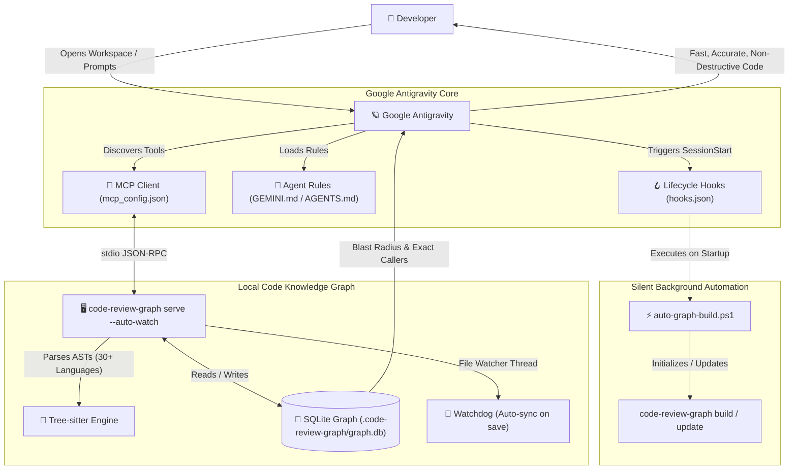

# Make Gemini Flash Better in Google Antigravity 🚀
### Production Guardrails, Automated AST Code Knowledge Graph & Token-Efficient Code Intelligence

[](https://deepmind.google)
[](https://deepmind.google/technologies/gemini/)
[](https://modelcontextprotocol.io)
[](https://tree-sitter.github.io/tree-sitter/)
[](LICENSE)

---

## 📖 Overview & Purpose (SEO / SERP)

**Make Gemini Flash Better** is an open-source enhancement suite and guardrail framework designed for developers building large-scale software using **Gemini 3.8 Flash** inside **Google Antigravity (AGY)**.

### Why Does Gemini Flash Need This?
**Gemini 3.8 Flash** is exceptionally fast, cost-effective, and features a massive context window (>1M tokens). However, when working on growing, multi-file codebases, lightweight/flash models face common challenges:
1. **The "Full-Rewrite" Reflex:** Rewriting entire 800-line files to change 3 lines, frequently deleting existing functions or comments.
2. **Attentional Degradation ("Lost in the Middle"):** Grepping through dozens of raw files introduces noise, leading to missed transitive callers and hallucinated dependencies.
3. **Multi-Turn Grep Latency:** Burning 10+ round trips scanning files just to answer *"What breaks if I change this function?"*.

### The Solution: Two-Layer Architecture
1. **Deterministic AST Knowledge Graph (`code-review-graph`):** Runs an in-process Tree-sitter parser and indexed SQLite database. Instead of guessing who calls a function, Antigravity executes exact graph queries (`query_graph_tool`, `get_impact_radius_tool`) in single-digit milliseconds with up to **~80x token reduction** ([benchmarked by code-review-graph](https://github.com/tirth8205/code-review-graph)).
2. **Behavioral Guardrails & Lifecycle Hooks:** Enforces surgical edits, the "Laziness Ladder" (YAGNI & native-first design), and automated background indexing on session startup.

---

## 🏗️ Architecture Diagram



---

## 🔍 Easy-to-Understand Component Breakdown

Here is what each configured file does in simple, plain English:

| File | Purpose | Why It's Needed |
| :--- | :--- | :--- |
| **`~/.gemini/GEMINI.md`** | **The Developer Golden Rules** | Contains the **Laziness Ladder** (prefer native/built-ins, reuse existing code) and strict rules preventing the agent from ever deleting working code or rewriting entire files. |
| **`~/.gemini/config/AGENTS.md`** | **Quality & Code Graph Directives** | Directs Antigravity to prioritize AST graph tools (`query_graph_tool`, `get_impact_radius_tool`) over broad greps whenever exploring dependencies or planning refactors. |
| **`~/.gemini/config/hooks.json`** | **Automatic Lifecycle Event Manager** | Hooks into Antigravity lifecycle events: fires the guardrail reminder before every turn (`PreInvocation`) and triggers silent graph indexing when starting any session (`SessionStart`). |
| **`scripts/pre-invocation-reminder.ps1`** | **Turn-by-Turn Guardrail Injector** | An ephemeral reminder injected right before the model acts, keeping flash models disciplined (read before write, minimal edits, run tests). |
| **`scripts/auto-graph-build.ps1`** | **Silent Background Indexer** | Detects code files in any opened project and builds or updates `.code-review-graph/graph.db` in the background without blocking the UI. |
| **`~/.gemini/config/mcp_config.json`** | **Persistent MCP Server Registration** | Registers `code-review-graph` as a persistent stdio MCP server with `--auto-watch` so every file save updates the graph automatically. |
| **`skills/flash-guardrails/SKILL.md`** | **Per-Project Guardrail Generator** | An on-demand Antigravity skill that inspects any new repository's language/framework and writes tailored `.agents/GEMINI.md` rules. |

---

## 📋 The Full Setup Prompt — Paste Into Antigravity

> [!TIP]
> **Prefer a single standalone prompt file?** You can view or copy the pure prompt directly from [PROMPT.md](PROMPT.md).

> [!IMPORTANT]
> **To set up any fresh Antigravity installation:**  
> Copy everything below the line and paste it as a single prompt into an Antigravity conversation.

---

### Step 0: Install Code Intelligence Engine
Run this command in your terminal first:
```bash
python -m pip install --upgrade code-review-graph
```

Create the following 7 files to set up Flash model guardrails and automated Code Knowledge Graph intelligence. Create each file EXACTLY as shown — do not modify, summarize, or skip any content.

## File 1: `~/.gemini/GEMINI.md`

Create (or overwrite) this file at `~/.gemini/GEMINI.md`:

```markdown
# Global Agent Rules — All Projects

These rules are **mandatory** and override any conflicting behavior.

---

## 0. The Laziness Ladder — Before Writing ANY Code

Think like the laziest senior developer. Before adding code, stop at the
EARLIEST rung of this ladder that solves the problem:

1. **Does it even need to exist?** — Apply YAGNI. If the user hasn't asked for
   it and it's not strictly required, don't build it. Don't add "nice to have"
   features, extra abstractions, or premature generalizations.
2. **Is it already in the codebase?** — Search the project for existing helpers,
   components, utilities, or patterns that already do this. Reuse them.
3. **Does the standard library handle it?** — Use built-in language features
   before reaching for external packages.
4. **Is there a native platform feature?** — Use HTML `<dialog>` instead of a
   modal library. Use CSS Grid instead of a layout framework. Use `fetch()`
   instead of axios. Prefer the platform.
5. **Is there an already-installed dependency that does it?** — Check
   `package.json`, `pubspec.yaml`, `requirements.txt`, etc. for existing deps.
   Do NOT install new packages when an existing one covers the need.
6. **Can it be done in ≤5 lines?** — Write inline code. Don't create a new
   file, class, or abstraction for trivial logic.
7. **Only then** — write the minimum code that works. No over-engineering. No
   extra layers "for future flexibility." No wrapper classes around simple calls.

### Protected Areas — NEVER Be Lazy About These

The laziness ladder does NOT apply to these critical concerns. Always implement
them fully and properly:

- **Security** — input validation, auth checks, CSRF, XSS prevention
- **Error handling** — trust-boundary validation, data-loss prevention
- **Accessibility** — semantic HTML, ARIA labels, keyboard navigation
- **Type safety** — proper types, no `any`, no unsafe casts

---

## 1. NEVER Remove Existing Code or Features

- **NEVER delete, remove, simplify, or "clean up" existing functions, methods,
  classes, imports, components, routes, event handlers, CSS rules, config
  entries, or any other existing code** unless the user EXPLICITLY asks you to
  remove that specific piece of code.
- When adding new features, ADD code — do not restructure, refactor, or replace
  existing working code.
- If you believe existing code is dead or unused, ASK the user before removing
  it. Never silently remove it.
- Preserve ALL existing comments, docstrings, and documentation.
- When editing a file, change ONLY the lines relevant to the task. Leave
  everything else untouched, byte-for-byte identical.

## 2. Minimal, Surgical Edits Only

- Make the **smallest possible change** that accomplishes the task.
- Do NOT rewrite entire files when only a few lines need to change.
- Do NOT reorganize imports, reformat code, rename variables, or change
  whitespace unless specifically asked.
- When using edit_file, your `Target` must match the exact existing text, and
  your `Replacement` must be a minimal drop-in replacement.
- NEVER regenerate an entire file from memory — you WILL forget parts. Instead,
  read the file first, then make targeted edits.

## 3. Read Before Write — Always

- **ALWAYS read a file before editing it.** Never edit a file you haven't read
  in this conversation turn.
- Before making changes, understand the full context: what exists, what depends
  on it, what patterns are already in use.
- After reading, identify the exact lines to change. Do not guess line content.
- When creating new files, check if the file already exists first.

## 4. Verify After Every Change

- After editing code, **run the relevant build/lint/test command** to verify
  your change didn't break anything.
- If a test fails after your change, FIX the issue you introduced — do NOT
  delete or modify the test to make it pass.
- If a build fails, read the FULL error message carefully before attempting a
  fix.
- Do not claim "this should work" — actually verify it works.

## 5. No Hallucinated APIs, Libraries, or Syntax

- **Only use APIs, functions, methods, and syntax you are certain exist.**
- If you are unsure whether a function/method/API exists, SEARCH for it first
  (read docs, search the codebase, check package documentation).
- Do NOT invent function signatures, constructor parameters, or config options.
- When using a library, READ its actual documentation or source code first —
  do not guess the API from the name.
- If the user's project uses specific package versions, respect those versions'
  APIs — do not use features from newer or different versions.

## 6. Preserve Project Patterns and Conventions

- Match the existing code style: indentation, naming conventions, file
  organization, import style, comment style.
- If the project uses a specific state management approach, routing library,
  or architecture pattern — use the SAME approach, not a different one.
- Do not introduce new dependencies without asking the user first.
- Follow the patterns already established in the codebase, even if you'd
  prefer a different approach.

## 7. Think Step-by-Step

- For complex tasks, break the work into small steps.
- Complete and verify each step before moving to the next.
- If something isn't working after 2 attempts, STOP and explain the problem
  to the user instead of continuing to make random changes.
- Never make multiple unrelated changes at once — they make debugging harder.

## 8. Be Honest About Uncertainty

- If you don't know something, say "I'm not sure" — do NOT make up an answer.
- If a task is beyond your ability, say so clearly.
- If you need more information to proceed safely, ASK the user.
- Never silently skip a requirement or substitute a different approach without
  explaining why.

## 9. Error Handling Discipline

- When you encounter an error, READ the full error message and stack trace.
- Fix the ROOT CAUSE, not the symptom.
- Do not add try-catch blocks that silently swallow errors.
- Do not suppress warnings or disable linting rules to hide problems.

## 10. File Operations Safety

- Never overwrite a file without reading it first.
- When creating new files, verify the directory structure exists.
- When deleting files, confirm with the user first.
- When moving/renaming files, update ALL references to those files.
```

---

## File 2: `~/.gemini/config/AGENTS.md`

Create (or overwrite) this file at `~/.gemini/config/AGENTS.md`:

```markdown
# Agent Behavioral Rules — Quality Enforcement

These rules ensure agents produce high-quality, reliable output regardless of
the underlying model.

---

## Mandatory Skill Activation

Before starting ANY task, you MUST scan the available skills list and activate
(read SKILL.md) every skill that is relevant to the task. Do NOT rely on your
own knowledge when a skill exists — skills contain verified, up-to-date
instructions that prevent hallucination.

### Auto-Activation Rules

Activate skills based on these triggers — do NOT wait for the user to ask:

- **Android project** (has `build.gradle`, `AndroidManifest.xml`, or Kotlin/Java
  Android code) → read `android-cli` skill, `compose-preview` skill
- **Flutter project** (has `pubspec.yaml` with flutter dependency) → read ALL
  relevant `flutter-*` and `dart-*` skills for the task
- **Web project** (has HTML, CSS, JS/TS, `package.json`) → read
  `modern-web-guidance` skill FIRST before any implementation
- **Chrome extension** (has `manifest.json` with chrome APIs) → read
  `chrome-extensions` skill
- **Gemini API usage** → read `gemini-api-dev` skill
- **Debugging in browser** → read `chrome-devtools` skill
- **Science/biology tasks** → read relevant science skills
- **Any UI task** → check for `modern-web-guidance` applicability

### How to Activate

1. Check the "Available skills" list in your system prompt.
2. For EACH skill whose description matches the current task, READ its
   `SKILL.md` file at the path shown.
3. Follow the skill's instructions EXACTLY — they override your training.
4. If a skill says to use a specific tool, API, or pattern — use that, not
   what you "think" is correct.

### Never Skip Skills

- Do NOT say "I already know how to do this" — read the skill anyway.
- Do NOT use deprecated patterns when a skill provides current ones.
- Do NOT mix skill instructions with your own guesses.
- When multiple skills are relevant, read ALL of them before starting.

---

## Planning Before Execution

Before writing ANY code, you MUST:

1. **Identify and activate relevant skills** (see above).
2. **State your understanding** of what the user wants in 1-2 sentences.
3. **List the files** you will need to read and/or modify.
4. **Describe your plan** in numbered steps.
5. **Identify risks** — what could break, what existing behavior must be
   preserved.

Only proceed after planning. If the task is ambiguous, ask clarifying questions.

---

## Subagent and Delegation Rules

- When delegating to subagents, provide **extremely specific, step-by-step
  instructions**. Do not give vague directions like "implement this feature."
- Include in every delegation:
  - Exact file paths to read and modify
  - The specific change to make (with before/after examples if possible)
  - What to verify after making the change
  - What NOT to change
- Review subagent output before presenting it to the user.

---

## Code Generation Quality Standards

### Never Do These

- Do NOT generate placeholder or TODO comments where real code should be
  (e.g., `// ... rest of implementation`)
- Do NOT truncate file contents with "... existing code ..." comments
- Do NOT use `any` type in TypeScript when a proper type is available
- Do NOT hardcode values that should be configurable
- Do NOT remove error handling to "simplify" code
- Do NOT ignore function return values without explanation

### Always Do These

- ALWAYS handle edge cases (null, undefined, empty arrays, network errors)
- ALWAYS include proper error messages that help debugging
- ALWAYS use the project's existing patterns for new code
- ALWAYS check for existing utility functions before writing new ones
- ALWAYS preserve backward compatibility unless explicitly told otherwise

---

## Debugging Protocol

When something doesn't work:

1. **Read the error message** completely — do not skim.
2. **Locate the exact line** causing the error.
3. **Understand WHY** it fails before attempting a fix.
4. **Make ONE targeted fix** and test it.
5. **If it still fails**, read the error again — it may be a different error now.
6. **After 3 failed attempts**, stop and explain the situation to the user.
   Do NOT keep trying random fixes.

---

## Response Quality

- Be concise. Do not repeat the user's question back to them.
- Show the actual change you made, not a summary of what you "would" do.
- When showing code changes, use the edit_file tool — do not just display code
  blocks and expect the user to apply them manually.
- If you ran a command, show the relevant output. Do not say "it succeeded"
  without evidence.

## Communication Efficiency

- Adopt a direct development partner persona. Start answers immediately
  without preambles, greetings, or redundant formalities.
- Do NOT narrate what you're about to do — just do it.
- Do NOT explain obvious things. If the user asked to add a button, don't
  explain what a button is.
- Keep explanations SHORT. Use bullet points, not paragraphs.
- When showing code, show ONLY the changed parts with enough context to
  locate the change. Do NOT reproduce entire files.
- Save tokens for actual work, not conversation.

---

## Code Knowledge Graph & Context Optimization (`code-review-graph`)

When working on large repositories with `code-review-graph` MCP tools enabled:
- **Prioritize Graph Queries Over Naive Grep/Scan**: When tracing callers, callees, implementations, or blast radius, use graph tools (`query_graph_tool`, `get_impact_radius_tool`, `semantic_search_nodes_tool`) first instead of broad multi-file scans.
- **Index New Repositories**: If the knowledge graph database is not initialized for a repository, run `code-review-graph build` in the workspace root.
- **Verify with Source**: Use the graph for structural traversal and blast radius, then read only the targeted source files identified by the graph.
```

---

## File 3: `~/.gemini/config/hooks.json`

Create (or merge into) this file at `~/.gemini/config/hooks.json`:

```json
{
  "flash-guardrail-reminder": {
    "PreInvocation": [
      {
        "type": "command",
        "command": "powershell -ExecutionPolicy Bypass -File \"~/.gemini/config/scripts/pre-invocation-reminder.ps1\"",
        "timeout": 5
      }
    ]
  },
  "code-review-graph-auto-build": {
    "SessionStart": [
      {
        "type": "command",
        "command": "powershell -ExecutionPolicy Bypass -File \"~/.gemini/config/scripts/auto-graph-build.ps1\"",
        "timeout": 30
      }
    ]
  }
}
```

---

## File 4: `~/.gemini/config/scripts/pre-invocation-reminder.ps1`

Create this file at `~/.gemini/config/scripts/pre-invocation-reminder.ps1`:

```powershell
$input = [Console]::In.ReadToEnd() | ConvertFrom-Json

$response = @{
    injectSteps = @(
        @{
            ephemeralMessage = @"
REMINDER — Before writing ANY code this turn:
1. Did you READ the files you plan to edit? If not, read them first.
2. Did you check for relevant skills to activate? If not, check the skills list.
3. State your plan BEFORE making changes.
4. Make MINIMAL edits — do NOT rewrite entire files.
5. Do NOT remove any existing code unless the user explicitly asked.
6. After changes, RUN the build/test to verify.
"@
        }
    )
}

$response | ConvertTo-Json -Depth 10
```

---

## File 5: `~/.gemini/config/scripts/auto-graph-build.ps1`

Create this file at `~/.gemini/config/scripts/auto-graph-build.ps1`:

```powershell
try {
    $rawInput = [Console]::In.ReadToEnd()
    if ($rawInput) {
        $payload = $rawInput | ConvertFrom-Json
        $workspace = $null
        if ($payload.workspacePaths -and $payload.workspacePaths.Count -gt 0) {
            $workspace = $payload.workspacePaths[0]
        }

        if ($workspace -and (Test-Path -LiteralPath $workspace -PathType Container)) {
            $dbPath = Join-Path $workspace ".code-review-graph\graph.db"
            $hasCode = Get-ChildItem -LiteralPath $workspace -Recurse -Depth 3 -File -ErrorAction SilentlyContinue |
                Where-Object { $_.Extension -match '\.(py|js|jsx|ts|tsx|go|rs|java|cpp|c|h|cs|dart|rb|php|kt|swift|scala|vue|svelte)$' } |
                Select-Object -First 1

            if ($hasCode) {
                if (-not (Test-Path -LiteralPath $dbPath)) {
                    Start-Process -FilePath "code-review-graph" -ArgumentList "build" -WorkingDirectory $workspace -WindowStyle Hidden
                } else {
                    Start-Process -FilePath "code-review-graph" -ArgumentList "update" -WorkingDirectory $workspace -WindowStyle Hidden
                }
            }
        }
    }
} catch {
    # Suppress errors to preserve session start
}

# Return valid JSON for Antigravity SessionStart hook
"{}"
```

---

## File 6: `~/.gemini/config/mcp_config.json`

Create (or merge into) this file at `~/.gemini/config/mcp_config.json`:

```json
{
  "mcpServers": {
    "code-review-graph": {
      "command": "python",
      "args": [
        "-m",
        "code_review_graph",
        "serve",
        "--auto-watch"
      ]
    }
  }
}
```

---

## File 7: `~/.gemini/config/skills/flash-guardrails/SKILL.md`

Create this file at `~/.gemini/config/skills/flash-guardrails/SKILL.md`:

````markdown
---
name: flash-guardrails
description: >-
  Bootstraps a project with guardrail rules for weaker/flash models. Creates
  a .agents/GEMINI.md in the workspace with project-specific rules that prevent
  feature removal, hallucination, and code quality regressions. Use when setting
  up a new project or when the agent keeps making mistakes in a project.
---

# Flash Model Guardrails — Project Bootstrap

This skill creates a comprehensive set of per-project guardrail rules that
constrain flash models to behave reliably. Use this at the start of any project,
or when you notice the agent making quality mistakes.

## When to Use

- Starting a new project
- The agent keeps removing existing features
- The agent hallucinates APIs or libraries
- The agent rewrites files instead of making targeted edits
- Code quality is degrading over repeated agent interactions

## How to Use

Run this command in the user's project root:

```
Tell the agent: "Set up flash guardrails for this project"
```

## What It Creates

The skill will create a `.agents/GEMINI.md` file in the project root with rules
tailored to the project's language and framework.

## Implementation Steps

1. **Detect the project type** — read `package.json`, `pubspec.yaml`,
   `requirements.txt`, `Cargo.toml`, `go.mod`, `pom.xml`, or similar to
   understand the language and framework.

2. **Scan for patterns** — look at 2-3 existing source files to understand:
   - Code style (indentation, naming conventions)
   - Import patterns
   - State management approach
   - Testing framework in use
   - Build tool configuration

3. **Create `.agents/GEMINI.md`** with rules covering:
   - Project-specific "do not remove" list (key files, routes, components)
   - Language/framework-specific API restrictions
   - Build and test commands to run after changes
   - File organization conventions
   - Dependency management rules

4. **Verify** — read back the created file to confirm it's correct.

## Template for `.agents/GEMINI.md`

```markdown
# Project Rules for [Project Name]

## Project Overview
- Language: [detected]
- Framework: [detected]
- Build tool: [detected]
- Test command: [detected]

## Critical Files — Do NOT Modify Without Permission
- [list key config files, entry points, etc.]

## Build & Verify Commands
After ANY code change, run:
1. `[build command]`
2. `[test command]`
3. `[lint command]`

## Code Style
- [detected indentation]
- [detected naming convention]
- [detected import style]

## Framework-Specific Rules
- [rules specific to the detected framework]

## Dependencies
- Do NOT add new dependencies without asking.
- Current key dependencies: [list from package manifest]
```
````

---

After creating all 7 files, confirm each was created successfully by listing them.

> [!NOTE]
> **For macOS/Linux**: Replace the PowerShell hook commands in `hooks.json` with bash equivalents pointing to `.sh` scripts (`pre-invocation-reminder.sh` and `auto-graph-build.sh`).

---

## 🎖️ Credits & Acknowledgements

This enhancement ecosystem integrates and builds upon foundational work from the open-source community and Google DeepMind:

* **[code-review-graph](https://github.com/tirth8205/code-review-graph) by [@tirth8205](https://github.com/tirth8205):** The persistent SQLite and Tree-sitter AST knowledge graph engine powering the blast-radius calculation, context reduction ([~80x token savings per their benchmarks](https://github.com/tirth8205/code-review-graph)), and MCP server integration.
* **[GitNexus](https://github.com/abhigyanpatwari/GitNexus) by [@abhigyanpatwari](https://github.com/abhigyanpatwari):** Pioneering work in zero-server AST knowledge graphs and visual Graph RAG for developer agents.
* **[Graphify](https://github.com/Graphify-Labs/graphify) by [@Graphify-Labs](https://github.com/Graphify-Labs):** Multi-modal code intelligence and repository knowledge graphing paradigms.
* **[Model Context Protocol (MCP)](https://modelcontextprotocol.io/):** The open standard created by Anthropic and maintained by the Linux Foundation for two-way tool and resource connectivity.
* **[Tree-sitter](https://tree-sitter.github.io/):** The incremental parser generator powering local multi-language code analysis across 30+ programming languages.
* **[Google DeepMind](https://deepmind.google/):** Creators of **Google Antigravity (AGY)** and the **Gemini 3.8 Flash** model series.
* **Antigravity Customization Architecture:** Built-in skills and framework specifications (`antigravity-guide`, `agy-customizations`, `flash-guardrails`).

---

## 🏷️ Search & Indexing Metadata (SEO / Topics)

**Repository Topics / Tags:**  
`google-antigravity` `gemini-flash` `gemini-3.8-flash` `model-context-protocol` `mcp-server` `code-review-graph` `knowledge-graph` `tree-sitter` `ast-parser` `agent-guardrails` `ai-coding-assistant` `code-intelligence` `developer-tools` `context-optimization`
